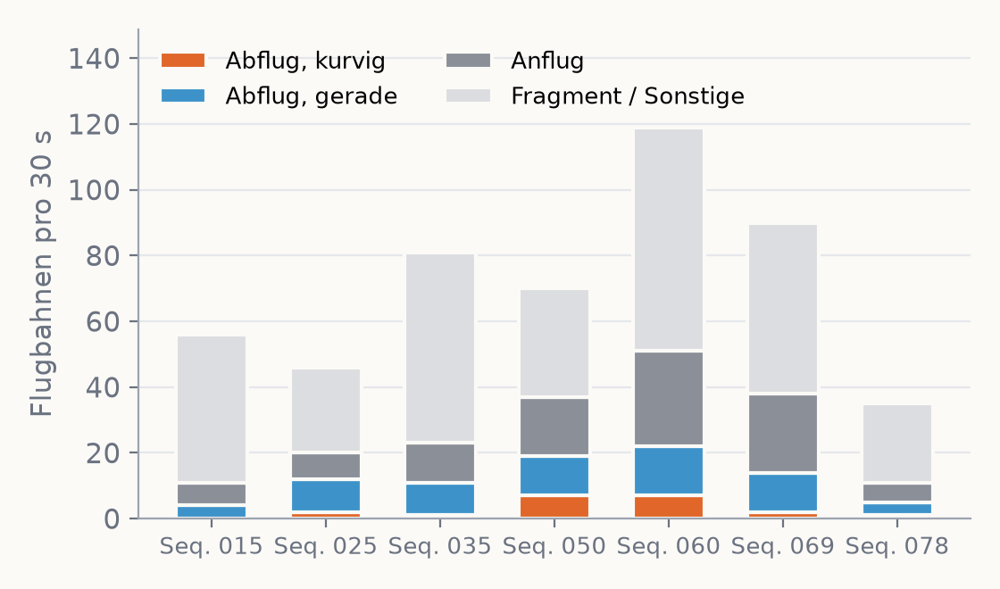

# Vorstudie: Machbarkeit

Stand: 28.10.2026. Ziel: prüfen, ob der Datensatz genug Flugbahnen und genug Orientierungsflug-Kandidaten
enthält, bevor das Thema angemeldet wird.

## Vorgehen

`beeflight-tracks` (Pipeline in [methode.md](methode.md), Abschnitte 1–3) auf sieben Sequenzen von Stock A,
verteilt über Training und Validierung, plus eine Sequenz von Stock B nur als Präsenzprüfung.

```bash
uv run beeflight-tracks rec2123_seq015 rec2123_seq025 rec2123_seq035 rec2123_seq050 \
                        rec2123_seq060 rec2123_seq069 rec2123_seq078
uv run beeflight-figures
```

## Ergebnisse

| Sequenz | Flugbahnen | Abflüge | davon kurvig | Anflüge | Brett → Brett | Fragmente / Durchflüge |
|---|---:|---:|---:|---:|---:|---:|
| rec2123_seq015 | 51 | 3 | 1 | 7 | 0 | 41 |
| rec2123_seq025 | 50 | 14 | 4 | 11 | 4 | 21 |
| rec2123_seq035 | 86 | 7 | 0 | 10 | 2 | 67 |
| rec2123_seq050 | 72 | 11 | 3 | 13 | 4 | 44 |
| rec2123_seq060 | 135 | 22 | 10 | 18 | 1 | 94 |
| rec2123_seq069 | 80 | 9 | 3 | 11 | 4 | 56 |
| rec2123_seq078 (Val.) | 35 | 4 | 0 | 6 | 0 | 25 |
| **Stock A gesamt** | **509** | **70** | **21** | **76** | **15** | **348** |
| rec2125_seq010 (Stock B, nur Präsenz) | 9 | 2 | 0 | 1 | 5 | 1 |



**Hochrechnung auf das Training** (55 Sequenzen): etwa 4.000 Flugbahnen, davon rund 550 Abflüge und
**~165 kurvige Abflüge**. Das reicht für einen Klassifikator mit einigen hundert Handlabels.

## Beobachtungen

- **Die Bahnen sind echt.** Ausschnitte entlang kurviger Bahnen zeigen eine Biene, oft schwach sichtbar und
  bewegungsunscharf vor dem Gras. Typische Formen: S-Kurven und Bögen über ~1 s, gehäuft direkt unterhalb des
  Fluglochs.
- **Gerade Bahnen queren die ganze Flugzone** (Abbildung in der README, blau), kurvige konzentrieren sich vor dem
  Eingang (orange). Das passt zum erwarteten Bild von Orientierungsflügen und suchenden Anflügen.
- **71 % Fragmente:** Die meisten Bahnen beginnen oder enden mitten im Gras. Die Biene ist dort getarnt und das
  Hintergrundmodell verliert sie. Das ist die größte technische Baustelle und das stärkste Argument für einen
  gelernten Detektor.
- **Artefakte:** Am Rand des Flugbretts entstehen kurze, zittrige „Schleifen“ (Bienen am Brettrand, keine Flüge).
  `abs_turn_deg` reagiert darauf stark, die Netto-Windung `turn_deg` kaum. Deshalb dient die Netto-Windung als
  Hauptmerkmal.
- **Seq. 015 und 035** haben viele Fragmente bei wenig Abflügen; in 035 ändert sich das Licht (Sonne/Schatten),
  das stört das Hintergrundmodell.
- **Stock B:** nur ~9 Flugbahnen in 30 s (bedeckt, kühler); die Bahnen sind aber sauber getrackt, eine
  Schleife ist dabei. Test B wird klein, das Wetter ist eine Störgröße für den Vergleich.

## Nachtrag: Tracker v2

Beim Labeln fiel auf, dass viele Bahnen mitten im Flug enden. Eine Analyse auf 6 Validierungssequenzen ergab drei
Ursachen, in dieser Reihenfolge der Wirkung:

1. **Zu enge Zonen.** Viele „verlorene“ Bienen landeten oder verließen das Bild, hörten aber 1–2 Bienenlängen vor
   der Zonengrenze auf, sichtbar zu sein (die Brettkante gehört zur Störmaske). Zonen 15 → 30 px: von 64 % auf
   38 % Bahnen mit einem Ende im Gras.
2. **Zu hohe Schwelle.** Getarnte Bienen über Gras unterschreiten `thr = 22`. Mit 18 steigen die vollständigen
   Bahnen um 12 %; 14 bringt kaum mehr, nur mehr Rauschen.
3. **Lücken.** Fragmente über Bewegungsvorhersage verbinden bringt nur 3 Prozentpunkte: Meist taucht die Biene
   gar nicht wieder auf, statt als neues Stück.

Die Störmaske war nicht die Ursache (nur 12 % der Abrisse liegen in ihrer Nähe).

| | v1 (Vorstudie) | v2 |
|---|---|---|
| Bahnen mit einem Ende im Gras, 7 Sequenzen oben | 74 % | 49 % |
| … Training (55 Sequenzen) | 69 % | 41 % |
| … Validierung (14 Sequenzen) | 66 % | 32 % |
| vollständige Bahnen, Training | 1292 | 2459 |
| Brett → Brett (Schleife und Landung), 7 Sequenzen | 15 | 63 |

Kurvige Abflüge werden etwas weniger (21 → 16 in den 7 Sequenzen), weil Schleifen, die wieder am Brett enden,
jetzt als Brett → Brett zählen: nach Leitfaden ebenfalls Orientierungsflüge. Die Folien zeigen noch die Zahlen
der Vorstudie.

## Bewertung

| Kriterium | Ergebnis |
|---|---|
| Genug Flugbahnen | ✅ ~70 pro 30 s in Stock A |
| Orientierungsflug-Kandidaten vorhanden | ✅ in 5 von 7 Sequenzen, ~3 pro 30 s |
| Vollständige Bahnen | ⚠️ nur 29 %, gelernter Detektor nötig |
| Test B aussagekräftig | ⚠️ wenig Verkehr, Konfidenzintervalle werden breit |
| Echtes Alter der Bienen als Ground Truth | ❌ nicht vorhanden; Ergebnis ist „Flugverhalten wie ein Orientierungsflug“ |

## Verworfene Themen (für die Diskussion)

Vor diesem Thema wurden andere Ideen am Datensatz geprüft. Die Prototypen liegen in `archive/prototypes/`.

| Idee | Warum verworfen |
|---|---|
| Flügelschlagfrequenz über den Rolling Shutter | Belichtung ≈ 4,2 ms ≥ eine Flügelschlagperiode; Flügel erscheinen nur als Schleier |
| Bewegungsunschärfe als Tacho (Belichtung aus den Daten kalibriert, ≈ 1/240 s) | machbar, aber der ML-Anteil wirkte zu dünn |
| Leichenträger und Drohnenschlacht (Ausräumen toter Bienen) | 35 min durchsucht: keine einzige verifizierbare Szene, Bienen zu klein |
| Washboarding (rhythmisches Schaukeln auf dem Brett) | kein periodisches Signal zwischen 1 und 8 Hz, kein Schaukeln sichtbar |
| Schatten fliegender Bienen für 3D-Bahnen | keine Schatten am Boden erkennbar |
| Kontaktnetzwerk und Erregerausbreitung | biologisch schwach: Kontakte im Stock dominieren |
