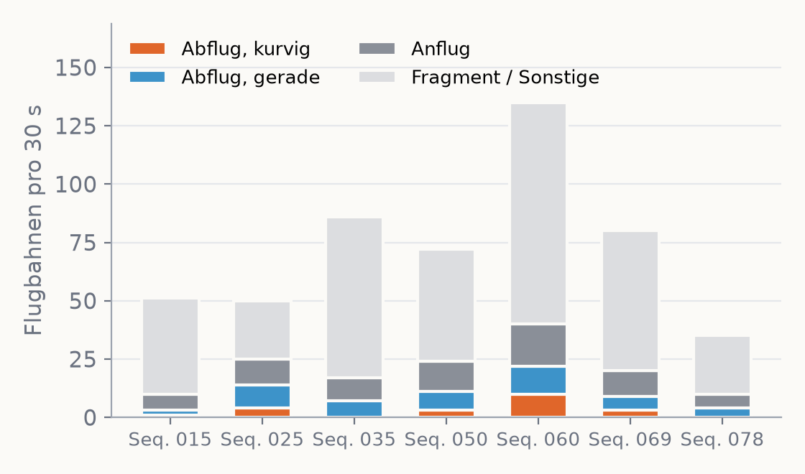

<!-- Folie 1 · Motivation & Daten -->

WDS224 · Machine Learning System Design and Operations

<h1>Orientierungsflug oder Sammelflug?</h1>Flugbahnen vor dem Flugloch als Indikator für neue Sammlerinnen

  
Erkennt ein Modell an der Flugbahn, ob eine junge Biene gerade ihren Stock kennenlernt?

  <ul class="m">
    <li>Vor dem ersten Sammelflug lernen junge Bienen die Lage ihres Stocks: <strong>Schleifen und Bögen</strong> mit Blick zum Flugloch statt direktem Abflug</li>
    <li>Anteil Orientierungsflüge ≈ <strong>Nachschub an Sammlerinnen</strong>, ein Maß für die Vitalität des Volkes</li>
    <li>Pestizide (Neonicotinoide) stören Orientierung und Heimfindung: ein Monitor am Flugloch wäre ein <strong>nicht-invasives Frühwarnsignal</strong></li>
  </ul>
  
<b>Capaldi et al. (2000)</b>: Orientierungsflüge per Harmonic Radar, <i>Nature</i> <b>Degen et al. (2015)</b>: Erkundungsverhalten bei Orientierungsflügen, <i>Animal Behaviour</i> <b>Henry et al. (2012)</b>: Pestizid senkt Heimkehrrate von Sammlerinnen, <i>Science</i>

  

    
<b>96 × 30 s</b>75 Seq. Stock A, 21 Stock B

    
<b>59,94 fps</b>1080 × 1920, GoPro

    
<b>Keine Labels</b>Start/Ziel der Bahn liefern Selbst-Labels

    
<b>A ≫ B</b>~70 vs. ~9 Flugbahnen pro 30 s

  

  
  
<b>Stock A</b>, Seq. 050, automatisch getrackt: <b style="color:#e0662a">kurvige Bahnen</b> kreisen vor dem Flugloch, <b style="color:#3d93c9">gerade Bahnen</b> queren die Flugzone

---

<!-- Folie 2 · Methode -->

## Methode: Flugbahnen selbst erzeugen, dann klassifizieren

  <ol>
    <li><strong>Vordergrund:</strong> Median-Hintergrund abziehen; Gras-Maske aus Pixeln, die &gt; 8 % der Zeit „bewegt“ sind</li>
    <li><strong>Tracking:</strong> Hungarian-Zuordnung mit Geschwindigkeitsvorhersage, Lücken bis 3 Frames</li>
    <li><strong>Selbst-Labels:</strong> Start auf dem Brett → Abflug, Ende auf dem Brett → Anflug; dazu Geradheit, Windung, Dauer</li>
    <li><strong>Handlabels:</strong> ~300 Bahnen in 4 Klassen: Orientierung · Sammelabflug · suchender Anflug · Artefakt</li>
    <li><strong>Lernen:</strong> Trajektorien-Encoder (GRU) gegen Baseline Krümmungsschwelle; Macro-F1, daraus Anteil Orientierungsflüge pro Sequenz</li>
  </ol>

  
  
<b>Vorstudie</b> auf Trainings- und Validierungsdaten (Stock A, 7 × 30 s): kurvige Abflüge in 5 von 7 Sequenzen; die meisten Bahnen reißen im Gras ab.

  

    

      
Training · Seq. 015–069

      

      
Validierung

      

      

    

    

    

      
Test B · Stock B

    

  

  
<b>Split nach Zeitblöcken</b>, nie nach Framesgrau: Puffer, verworfen<b style="color:var(--test-a)">Test A</b> gleicher Stock, 2 min<b style="color:var(--test-b)">Test B</b> neuer Stock, 10,5 minTuning nur auf Validierung

---

<!-- Folie 3 · Ergebnisse & Diskussion -->

## Ergebnisse und Diskussion

  

Flugbahnen

509

in 7 × 30 s Stock A, davon 70 Abflüge und 76 Anflüge

  

Kurvige Abflüge

21

≈ 3 pro 30 s → ~165 Kandidaten im Training (Vorstudie)

  

Fragmente

71 %

Bahn beginnt oder endet im Gras: Biene geht verloren

  

Test A / B · Macro-F1

– / –

GRU vs. Krümmungs-Baseline

  <h3>Erkenntnisse und Grenzen</h3>
  <ul>
    <li><strong>Kurvig ≠ Orientierung:</strong> auch suchende Anflüge und Ausweichmanöver kurven, genau das muss das Modell trennen</li>
    <li><strong>Tarnung:</strong> Bienen über Gras kaum sichtbar, daher 71 % Fragmente</li>
    <li><strong>Blickrichtung</strong> zum Stock bei ~30 px Körperlänge nicht sicher messbar</li>
    <li><strong>Stock B bedeckt:</strong> ~9 Flugbahnen pro 30 s, Test B klein; Wetter als Störgröße</li>
  </ul>

  <h3>Nächste Schritte</h3>
  <ul>
    <li>Detektor für die Flugzone trainieren, Fragmente zu ganzen Bahnen verbinden</li>
    <li>~300 Bahnen von Hand labeln, Inter-Rater-Check an 50 Bahnen</li>
    <li>GRU gegen Baseline auf Test A und B, Anteil Orientierungsflüge über die Zeit</li>
  </ul>
  
<strong>Offene Frage:</strong> Trennt die Bahnform allein Orientierung von suchender Landung, oder braucht es den Startpunkt?

