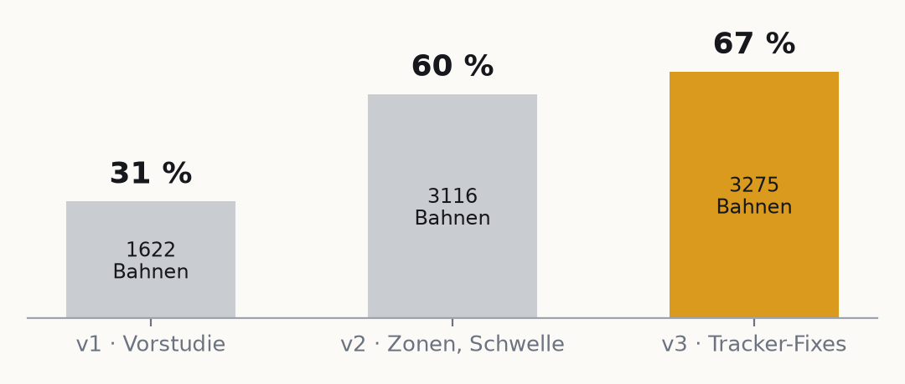

<!-- Folie 1 · Motivation & Daten -->

WDS224 · Machine Learning System Design and Operations

<h1>Orientierungsflug oder Sammelflug?</h1>Flugbahnen vor dem Flugloch als Indikator für neue Sammlerinnen

  
Erkennt ein Modell an der Flugbahn, ob eine junge Biene gerade ihren Stock kennenlernt?

  <ul class="m">
    <li><strong>Orientierungsflug:</strong> Vor dem ersten Sammelflug fliegen junge Arbeiterinnen mehrere Erkundungsflüge. Am Flugloch wenden sie sich zum Stock und fliegen <strong>Bögen und Schleifen</strong>; mit jedem Flug schneller und weiter, abhängig von Erfahrung, nicht Alter</li>
    <li><strong>Zweck:</strong> Sie lernen Landschaftsmerkmale, mit denen sie später heimfinden. Ohne Orientierungsflüge keine Sammlerin</li>
    <li><strong>Indikator:</strong> Anteil Orientierungsflüge ≈ Nachschub an Sammlerinnen. Eine Kamera am Flugloch misst das <strong>nicht-invasiv</strong>, ohne Radar oder RFID, z. B. als Frühwarnsignal bei Pestiziden</li>
  </ul>
  
<b>Capaldi et al. (2000)</b>: Ontogenese des Orientierungsflugs, Harmonic Radar, <i>Nature</i> <b>Degen et al. (2016)</b>: Bienen lernen Landschaftsmerkmale beim Orientierungsflug, <i>Curr. Biol.</i> <b>Henry et al. (2012)</b>: Pestizid senkt Heimkehrrate von Sammlerinnen, <i>Science</i>

  

    
<b>96 × 30 s</b>75 Seq. Stock A, 21 Stock B

    
<b>59,94 fps</b>1080 × 1920, GoPro

    
<b>Keine Labels</b>Start/Ziel der Bahn liefern Selbst-Labels

    
<b>A ≫ B</b>~75 vs. ~9 Flugbahnen pro 30 s

  

  
  
<b>Stock A</b>, Seq. 050, automatisch getrackt: <b style="color:#e0662a">kurvige Bahnen</b> kreisen vor dem Flugloch, <b style="color:#3d93c9">gerade Bahnen</b> queren die Flugzone

---

<!-- Folie 2 · System -->

## System: vom Rohvideo zum Indikator

  

1
<b>Tracking</b>Hintergrundmodell, Hungarian-Zuordnung, Fragmente verbinden<code>beeflight-tracks</code>

  

2
<b>Selbst-Labels</b>Start/Ziel am Brett, Geradheit, Windung → stratifizierte Stichprobe<code>beeflight-sample</code>

  

3
<b>Handlabels</b>Web-App, 4 Klassen, 3 Stimmen pro Bahn, Mehrheit entscheidet<code>labeler/ · beeflight-vote</code>

  

4
<b>Modell</b>GRU auf der Bahn vs. Krümmungs-Baseline, Macro-F1<code>PyTorch</code>

  

5
<b>Indikator</b>Anteil Orientierungsflüge pro Sequenz über die Zeit<code>beeflight-run</code>

  <h3>Designentscheidungen</h3>
  <ul class="d">
    <li><strong>Labels überleben Tracker-Updates:</strong> jedes Label speichert die Bahn und die Tracker-Version; nach v2 und v3 wurden die Labels automatisch auf dieselben Flüge übertragen</li>
    <li><strong>Mehrere Labelnde:</strong> Freunde labeln online kurze Clips (GitHub Pages), nach einer Übungsrunde mit Rückmeldung; Übereinstimmung als Krippendorffs α</li>
    <li><strong>Kein Leck:</strong> Split nach Zeitblöcken mit Puffer, Schwellen nur auf Validierung, eigene Testlabels und Auswertung erst nach dem Einfrieren</li>
  </ul>

  
  
<b>Label-App:</b> Zeitlupe in Schleife, Bahn synchron eingezeichnet, Tasten 1–4

  

    

Training · Seq. 015–069

Validierung

    

Test B · Stock B

  

  
<b>Split nach Zeitblöcken</b>, nie nach Framesgrau: Puffer, verworfen<b style="color:#d99a1e">Test A</b> gleicher Stock, 2 min<b style="color:#b5541c">Test B</b> neuer Stock, 10,5 min

---

<!-- Folie 3 · Ergebnisse & Diskussion -->

## Ergebnisse und Diskussion

  
  
<b>Fehleranalyse statt Bauchgefühl:</b> Anteil vollständiger Bahnen (Start und Ende am Brett oder Bildrand). v2: Zonen zu eng, Schwelle zu hoch. v3: geteilte Blobs, enge Kurven, Neustarts.

  

Flugbahnen

4923

Training + Validierung, Stock A, 34,5 min

  

Kurvige Abflüge

168

plus 677 Brett → Brett (Schleifen oder kurze Hüpfer)

  

Handlabels

165 / 380

Ziel: 3 Stimmen pro Bahn, Krippendorffs α

  

Test A / B · Macro-F1

– / –

GRU vs. Krümmungs-Baseline

  <h3>Erkenntnisse und Grenzen</h3>
  <ul>
    <li><strong>Kurvig ≠ Orientierung:</strong> auch suchende Anflüge kurven, genau das muss das Modell trennen. Auch Menschen: erste Zweitstimmen 65 % gleich, 22 von 31 Abweichungen sind „Orientierung“</li>
    <li><strong>Tarnung:</strong> über dem Gras reißen noch 33 % der Bahnen an einem Ende ab</li>
    <li><strong>Stock B bedeckt:</strong> ~9 Bahnen pro 30 s, Test B klein</li>
  </ul>

  <h3>Nächste Schritte</h3>
  <ul>
    <li>380 Bahnen mit je 3 Stimmen labeln, α berichten</li>
    <li>GRU gegen Baseline auf Test A und B, Indikator über die Zeit</li>
    <li>Gelernter Detektor gegen die restlichen Abrisse, wenn Zeit bleibt</li>
  </ul>
  
<strong>Offene Frage:</strong> Reicht die Bahnform, oder braucht es den Startpunkt?

